# Portfolio website

[View portfolio](https://huffmanks.com)

## Projects

### Pocket Player

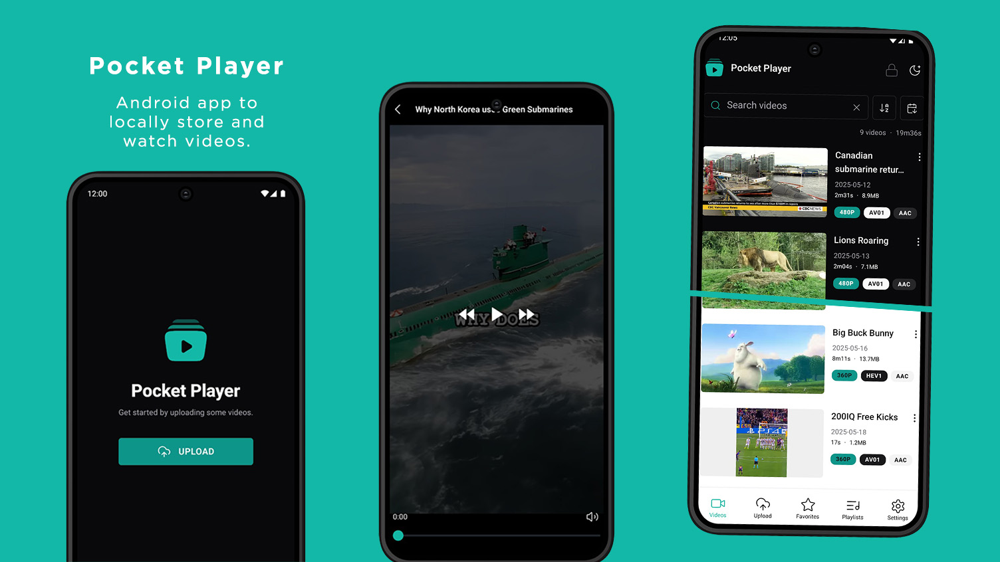

Android app to locally store and watch videos offline.

- [Repo](https://github.com/huffmanks/pocket-player)
- [APK](https://github.com/huffmanks/pocket-player/releases)

### Web Tools

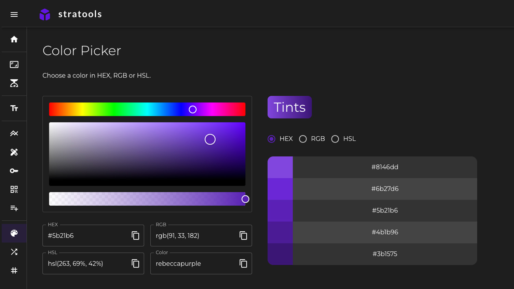

Development tools for the web, installable as a PWA.

- [Repo](https://github.com/huffmanks/tools-nextjs)
- [Demo](https://tools.huffmanks.com)

### CodeShare

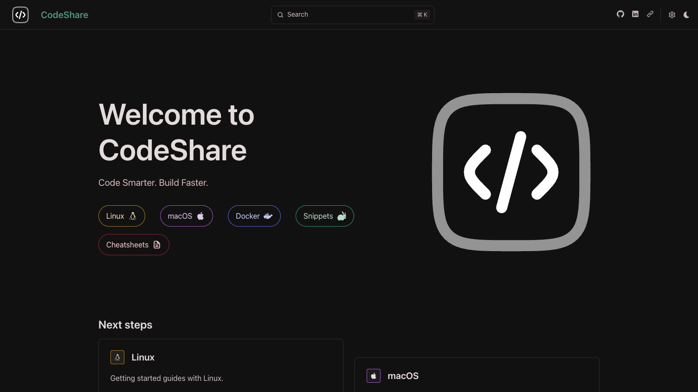

CodeShare is your go-to platform for clear, practical coding guides and reusable code snippets.

- [Repo](https://github.com/huffmanks/code-share)
- [Demo](https://codeshare.huffmanks.com)

### EchoLink

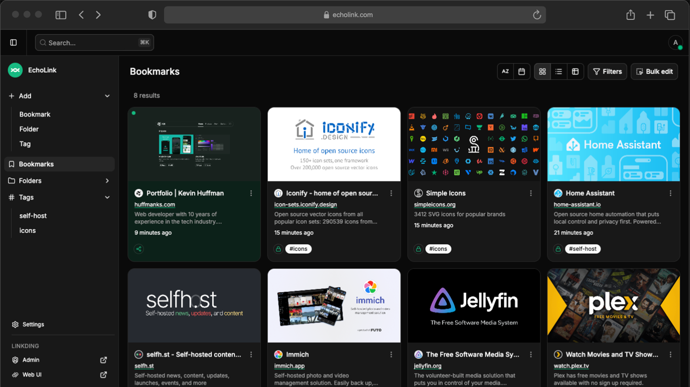

Self-hosted client app for Linkding.

- [Repo](https://github.com/huffmanks/echo-link)
- [Image](https://hub.docker.com/r/huffmanks/echo-link)

### pastebox

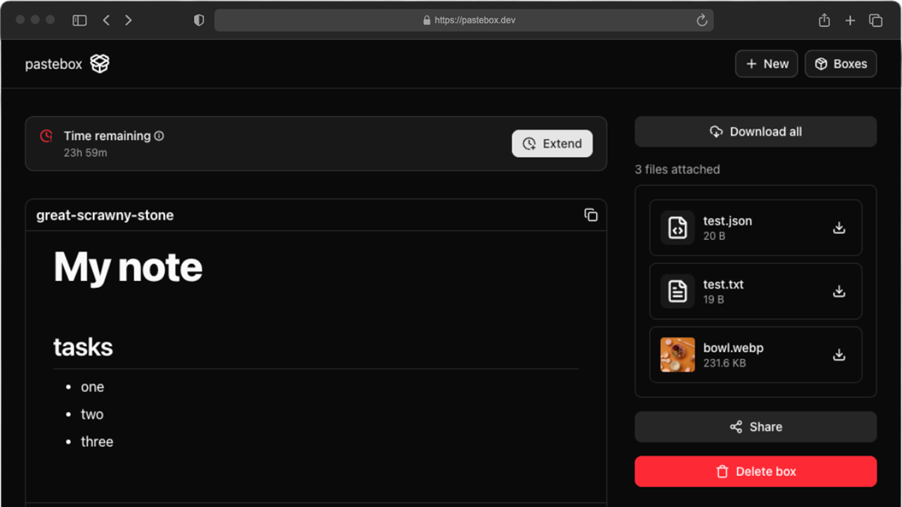

A lightweight, self-hosted tool for ephemeral rich text and file sharing on your local network.

- [Repo](https://github.com/huffmanks/pastebox)
- [Image](https://hub.docker.com/r/huffmanks/pastebox)

### Weekly Word

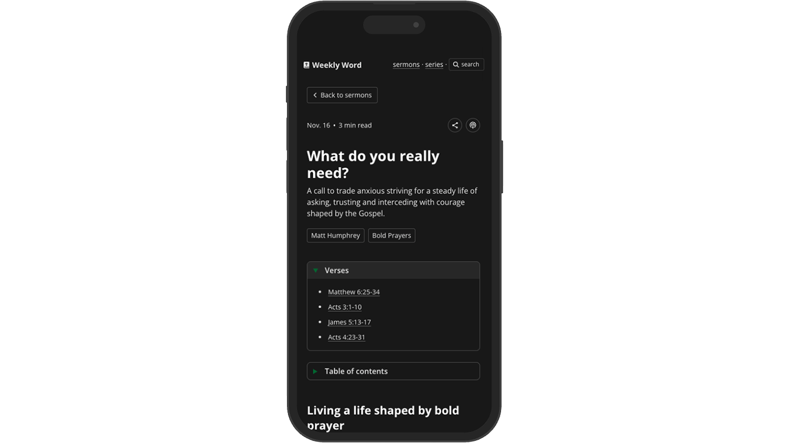

Personal collection of my sermon notes and thoughts from each week.

- [Repo](https://github.com/huffmanks/weekly-word)
- [Demo](https://word.huffmanks.com)

### Email Builder

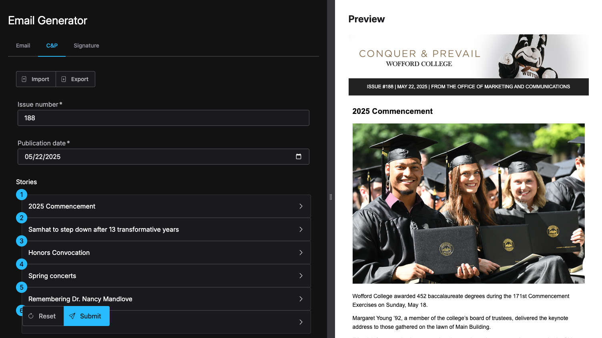

Internal tool for generating MJML-based emails and company-specific email signatures.

- [Demo](https://email.huffmanks.com)

### Wofford Homepage

Visual design concept for the Wofford College homepage.

- [Design](https://huffmanks.com/projects/design/wofford-homepage)

### Nostra

Static design mockup for an e-commerce landing page.

- [Design](https://huffmanks.com/projects/design/ecommerce-page)

### Funflow

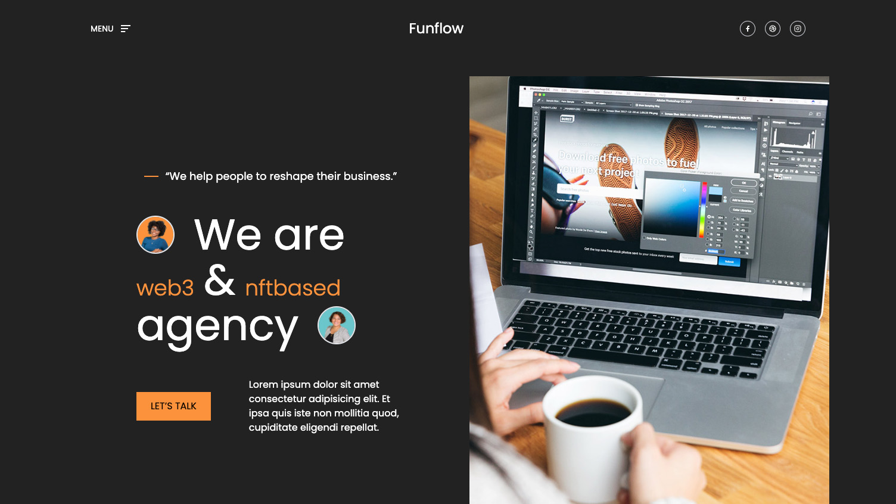

Concept landing page for a fictional company or startup.

- [Design](https://huffmanks.com/projects/design/landing-demo)

### Protion

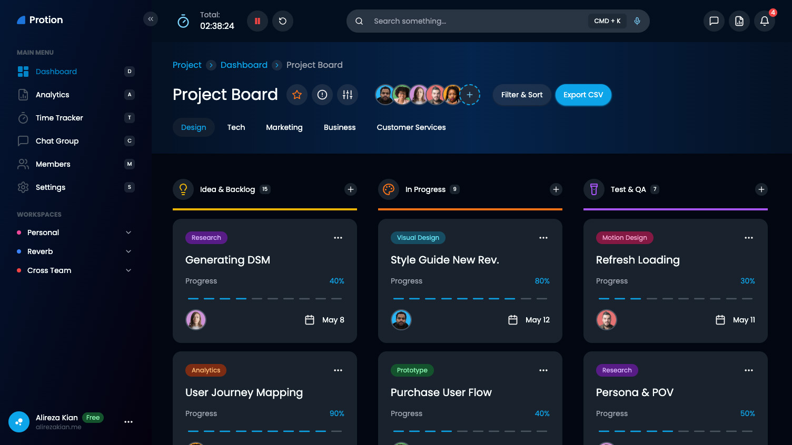

UI design for a SaaS dashboard with clean, modern layout.

- [Design](https://huffmanks.com/projects/design/saas-dashboard)

### Diff Tool

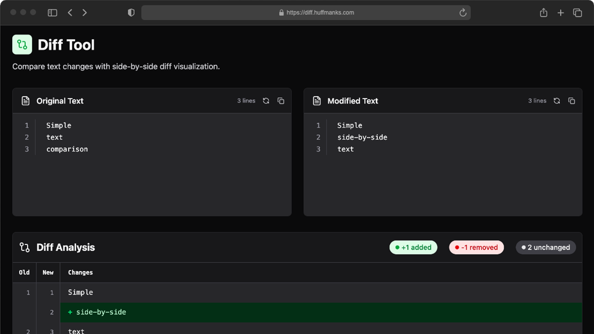

Simple side-by-side text comparison tool for spotting changes quickly and clearly.

- [Repo](https://github.com/huffmanks/diff-tool)
- [Demo](https://diff.huffmanks.com)

### Listography

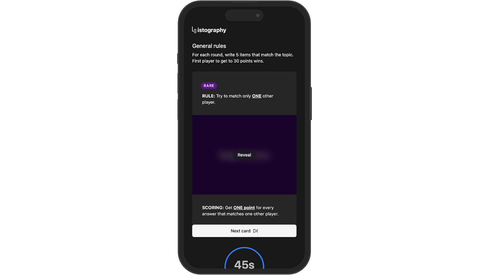

The ultimate party game where your lists spark laughter, debate and unforgettable moments.

- [Repo](https://github.com/huffmanks/listography)
- [Demo](https://listography.huffmanks.com)

### Quiz App

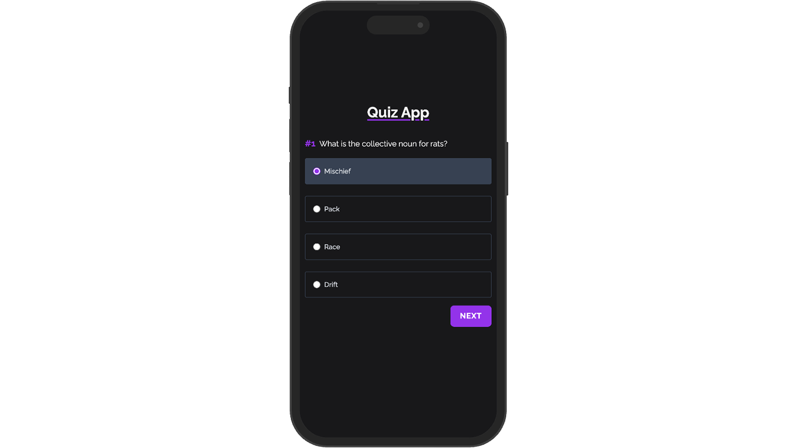

Take a quiz with various categories and difficulties to choose from.

- [Demo](https://huffmanks.com/projects/apps/quiz)

### Weather App

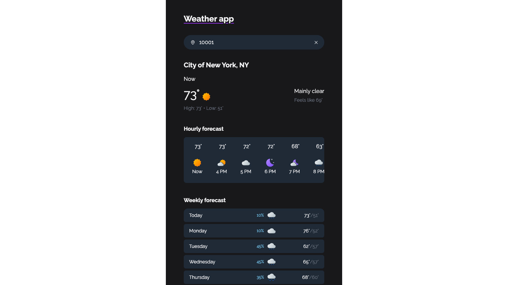

Quickly check current weather by entering a city name or ZIP code.

- [Demo](https://huffmanks.com/projects/apps/weather)

### Palette Paste

VS Code extension for inserting structured, repetitive text patterns using custom templates and sequences.

- [Repo](https://github.com/huffmanks/palette-paste)
- [Extension](https://marketplace.visualstudio.com/items?itemName=huffmanks.palette-paste-ext)

### stash

An interactive CLI tool to bootstrap system packages and dynamically build platform-specific zsh and git configurations.

- [Repo](https://github.com/huffmanks/stash)

### Ingeniux CMS Companion Extension

Browser extension that adds a “View Live” link inside Ingeniux CMS, dynamically resolving the current asset or page and opening it on the correct publishing target.

- [Repo](https://github.com/huffmanks/ingeniux-cms-companion-extension)

### kokoro-tts-cli

Simple CLI for generating speech locally with Kokoro ONNX. Supports single, multiple and blended voices with optional MP3 output.

- [Repo](https://github.com/huffmanks/kokoro-tts-cli)

### Mock API

Mock API for serving test data like users and products.

- [Repo](https://github.com/huffmanks/mock-api)

### mlx-portrait-gen

Build and operate a local, automated AI headshot generation pipeline using structured person data.

- [Repo](https://github.com/huffmanks/mlx-portrait-gen)

### Obsidian Copy Note Plugin

Adds a button to the file header to copy the entire file content to the clipboard.

- [Repo](https://github.com/huffmanks/obsidian-copy-note)

### Photoshop Plugin: Auto-fit layer

Instantly resizes the selected layer to match the artboard.

- [Repo](https://github.com/huffmanks/photoshop-plugin-auto-fit-layer)

### Recipe Scrapy

Python scraper for collecting structured recipe data from websites.

- [Repo](https://github.com/huffmanks/recipe-scrapy)

### Slack Tot Bot

A Slack bot that alerts when tater tots are on the menu.

- [Repo](https://github.com/huffmanks/slack-tot-bot)
